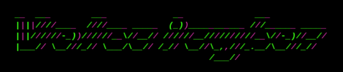
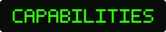
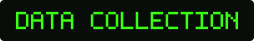

  <p align="center">
  
</p>

<p align="center">
  
</p>

> [!CAUTION]
> **Responsible use and liability disclaimer**
>
> Velocicyber is intended for authorized red-team and blue-team security research,
> testing, and education. It is not intended for illegal, unauthorized, or unethical
> activity. Use it only on systems you own or have explicit permission to assess,
> and stay within the agreed scope.
>
> You are responsible for obtaining all required permissions and complying with
> applicable laws. Misuse may result in civil or criminal penalties.
>
> This software is provided "as is", without warranties. To the fullest extent
> permitted by applicable law, its authors, contributors, and maintainers disclaim
> liability for any damage, loss, misuse, or unintended consequences arising from
> its use. You are responsible for reviewing and supervising actions performed by
> the harness.
>
> **Model backdoor risk:** Open-weight models and third-party modifications can
> contain hidden behavior. [Research on cryptographic model backdoors](https://arxiv.org/abs/2406.02619)
> shows why testing may fail to reveal such behavior, even with access to the
> model's internals. Treat model outputs and tool calls as untrusted. Successful
> downloads, checksums and ordinary coding tests do not certify a model as safe.

Velocicyber is a terminal coding harness for authorized red-team, blue-team,
and security research. It pairs one coding agent with a human operator and an
optional local scope observer. The primary target is a **Raspberry Pi 5 with
16 GB RAM running 64-bit Linux**.

**Beta and under active development.** Model availability and live
validation vary by provider and serving profile. See [model setup](docs/models.md)
and each model's **More Details** menu before choosing hardware.

<a name="capabilities"></a>

## 

- Use CyberKimi or CyberGLM through the Adverserial.ai confidential API client.
- Select a supported Lambda GPU model, review compatible capacity and hourly
  pricing, then approve instance launch and model deployment.
- Run the Qwen or BugTrace Pi CPU profiles after installing their optional weights
  and serving runtime.
- Start and resume conversations, queue follow-up prompts, interrupt work, and
  receive notices when context compaction occurs.
- Choose the engine's workspace sandbox or open filesystem access using your
  Linux account's permissions.
- Use a local sentinel to review executable tool actions against `SCOPE/SCOPE.MD`
  asynchronously and stop a task after a possible violation is detected.
- Collect and prepare main-agent and sentinel data, with optional manual or
  automatic publication to separate Hugging Face datasets you configure.
- Check upstream engine releases on launch and manually approve a staged update
  or rollback. Updates are tested before activation.

<a name="current-model-options"></a>

## 

| Role | Included choices |
| --- | --- |
| API coding | CyberKimi; CyberGLM |
| Raspberry Pi CPU coding | Qwen3.5-35B-A3B IQK; BugTrace APEX Mini |
| Lambda GPU coding | M.O.G.-SEC 27B; OrcaCyber Nano; CYBER-FROST 3.8 BF16; GLM-5.3 Flash EXL3/TensorFold; SAGE-A1P5 BF16 V2 |
| Local sentinel | Qwen3.5-35B-A3B IQK; Granite Guardian 4.1 8B Q4 |

Repository IDs are in [Modules.example.txt](Modules.example.txt); hardware,
context limits and validation status are in [model setup](docs/models.md) and
**More Details**. Several GPU profiles still need live Lambda validation.
Additional models/providers require compatible profiles or adapter work; changing
a repository name alone does not establish support.

<a name="quick-start"></a>

## 

After downloading or cloning this repository:

```bash
./install.sh
./velocicyber.sh
```

The Python installer needs Python 3.11+ with `venv` and internet access. The
execution engine is installed separately during optional setup. Pi runtime builds
also need Git, CMake and a C++ compiler; the Adverserial API client needs Node.js
and npm. See [installation](docs/installation.md) for platform requirements.

First launch asks for your Lambda, Adverserial.ai and Hugging Face credentials,
and separate main-agent and sentinel dataset names. Each optional item can be
skipped. Keys stay in your local `.env`; other settings go in `Modules.txt`.
Collection and uploads start **OFF**. No GPU model is selected automatically, and
model weights are downloaded only through an explicit setup/model selection.
Lambda use also requires your own registered SSH key; see [SSH setup](ssh-keys/README.md).

For a download without Git, use the [curl installation instructions](docs/installation.md#download-with-curl).
Downloading requires GitHub read access.

To inspect setup or try the interface without provider requests:

```bash
./velocicyber.sh doctor
./velocicyber.sh --demo
```

Run `./velocicyber.sh setup` to revisit credentials and optional installations.

<a name="using-the-harness"></a>

## 

Type `/` and a command name to filter the menu. Submenus use the same filtering
style. Confirming a model from the home screen starts a new conversation; use
`/resume` to reopen saved history. The dashboard identifies the active model.

| Command | Purpose |
| --- | --- |
| `/api`, `/local` | Choose a coding model; local selections offer confirmation and details |
| `/gpu`, `/terminate` | Manage a Lambda instance and review launch pricing |
| `/new`, `/resume`, `/home` | Start, resume, or return to the main menu |
| `/queue` | Inspect, pause, resume, or clear queued prompts |
| `/sandbox` | Select workspace restrictions or open access with your account permissions |
| `/sentinel` | Select the local observer and turn it ON/OFF |
| `/data-collection`, `/upload-perms` | Control collection, manual/automatic uploads and data retention |
| `/updates-info`, `/update-engine` | Inspect engine release/advisory information or approve maintenance |
| `/help`, `/quit` | Show help or end the session and terminate its tracked GPU |

Enter queues a prompt while the agent is busy. **Ctrl+X** stops the current task
and pauses the queue. Use `/quit` for normal shutdown; after a crash or power
loss, check Lambda because billing continues until the instance is terminated.

<a name="data-collection"></a>

## 

Main-agent records and sentinel observations use separate datasets configured by
`FINETUNING_REPO` and `SENTINEL_FINETUNING_REPO`. Shared collection/upload controls
apply to both. Eligible records are sanitized and deduplicated before upload;
confirmed uploads allow cleanup of their local collected copies. Saved
conversation history for `/resume` is separate.

`/data-collection` includes **Manual Upload**, **Allow compaction?**, local data
deletion, and advanced task-ID/verification settings. **Allow compaction?** controls
whether compacted sessions enter the dataset; automatic context compaction
remains available. Fine-tuning itself runs outside this harness. Review collected
data before training: completion does not prove correctness, and sentinel
predictions are not verified labels. See [data handling](docs/usage.md#data-and-sentinel).

<a name="current-limitations"></a>

## 

- The engine/runtime installation path targets Linux ARM64 on the Pi. Other
  platforms, including x86-64 Linux/WSL2, Windows and macOS, need compatible
  runtimes and validation.
- GPU deployment is integrated with Lambda. Personal-workstation GPU management
  and additional cloud/API providers need integration work.
- Only one Pi coding model can run at a time. A Pi coding model and local sentinel
  cannot run together; pair the sentinel with an API or Lambda coding model.
- The sentinel is a reactive observer. Reviews can be slow or incorrect, and an
  action can finish before its verdict. It cannot guarantee scope enforcement or
  undo completed actions. Prepare a real scope file using [these instructions](SCOPE/README.md).
- Model context limits, memory needs and startup estimates depend on the selected
  profile. GPU performance depends on the hardware, model and serving configuration.
- Each installation has separate configuration and runtime data. Run one
  installation's live local runtimes at a time because default ports are shared.

The harness uses a separately installed official Open Interpreter engine.
Engine updates require approval and compatibility checks; the harness source
itself is updated separately. Inspect `/updates-info` when a release check fails.
See [security boundaries](SECURITY.md) and [third-party notices](THIRD_PARTY_NOTICES.md).
An original-code distribution license must be chosen before public release.

<a name="guides"></a>

## 

| Guide | Contents |
| --- | --- |
| [Installation](docs/installation.md) | curl download, first-run setup, credentials and manual configuration |
| [Model setup](docs/models.md) | Lambda SSH setup, GPU profiles and optional Pi downloads |
| [User guide](docs/usage.md) | Sessions, queued prompts, data collection and sentinel behavior |
| [Architecture and development](docs/development/architecture.md) | Source map, model extensions, engine updates and tests |
| [Sources and upstream references](docs/sources.md) | Documentation, model cards, version pins and integration modules |
| [Release checklist](docs/development/release-plan.md) | Completed milestones, validation and remaining release gates |

<a name="repository-layout"></a>

## 

```text
velocicyber/     Python application, grouped by responsibility
config/locks/   Pinned engine, model and serving runtime metadata
scripts/        Installers, runtime helpers, maintenance and validation tools
tests/          Offline regressions and engine compatibility checks
docs/           Setup, usage, architecture and release checklist
assets/         Desktop icon and branding
chat-templates/ Attributed model chat templates
SCOPE/          Scope example and location for your private scope file
ssh-keys/       Instructions and location for your private Lambda key
```

<a name="acknowledgements"></a>

## 

Thanks to the upstream projects and model publishers used by this harness:

- [Adverserial.ai](https://www.adverserial.ai/)
- [Blackfrost-AI](https://huggingface.co/Blackfrost-AI) and [Blackfrost-Research](https://huggingface.co/Blackfrost-Research)
- [Open Interpreter](https://github.com/openinterpreter/openinterpreter)
- [Mia-AiLab](https://huggingface.co/Mia-AiLab)
- [IBM Granite](https://huggingface.co/ibm-granite)
- [mtrpires](https://huggingface.co/mtrpires)
- [terrorswift](https://huggingface.co/terrorswift)
- [OrcaRouter](https://huggingface.co/orcarouter)

Serving-runtime attribution and pinned source references are in
[Sources and upstream references](docs/sources.md#model-serving-runtimes).
