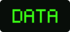
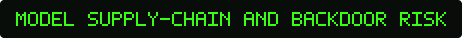

# 

## 

- Use only your own credentials. Setup hides key entry and writes `.env` and `Modules.txt` atomically with `0600` permissions. Keep these permissions when copying them manually.
- Secrets, personal scope documents, SSH keys, runtime state, model weights, conversations and training records are excluded from Git. Never override these exclusions with a forced add.
- There are no default maintainer dataset destinations. Both datasets are optional, separately configured, and must differ. Collection and upload permissions start off.
- Runtime and model installers use pinned source revisions or artifacts; model/engine archives are checksum-verified. Python dependencies are version-pinned, but the lock does not provide package artifact hashes.

## 

Inference privacy and local execution permissions protect different boundaries.
Commands run on the local machine even when inference runs through an API or
Lambda. The Lambda model-serving container does not contain those local commands.

### 

| Inference location | Privacy benefit and boundary |
| --- | --- |
| Pi | Model inference can keep inputs on the device. Network tools, local logs and optional dataset uploads are separate data paths. |
| Self-managed Lambda | Users control the serving application and its logging. Inference inputs leave the Pi, and the deployment still relies on cloud infrastructure; it does not automatically provide confidential computing. |
| Adverserial confidential API | The [pinned SDK](https://github.com/AdverserialAI/confidential-sdk) verifies attestation and workload evidence and uses encrypted transport. Protection depends on its documented hardware and verification assumptions. |

Confidential inference does not imply universal zero retention. Adverserial's
[privacy policy](https://adverserial.ai/privacy) describes temporary processing
and caches, account-linked usage records and separate retention lifecycles.
Do not bypass the confidential client's attestation or TLS checks to resolve
availability errors.

### 

- **Default execution restrictions:** closed mode uses the engine's enforced
  restrictions on file writes and tool network access, independently of whether
  the model follows instructions.
- **Credential handling:** long-lived provider credentials are kept out of the
  execution engine's inherited environment. Setup saves private configuration
  with owner-only permissions; private files are excluded from Git.
- **Scope monitoring:** the optional sentinel reviews executable actions against
  `SCOPE/SCOPE.MD` asynchronously and can interrupt the current task.
- **Controlled updates and collection:** managed engine updates require approval
  and are staged and compatibility-tested before activation. Collection and
  dataset uploads have user-controlled permissions and default to off in new
  installations.

### 

- **Personal-file isolation is incomplete.** Closed mode does not hide files
  readable elsewhere in the user's Linux account, including personal documents
  or credentials. Keeping a secret outside the workspace or setting `0600` does
  not prevent access by agent tools running under that same account.
- **Open mode grants account-level access.** Executed commands receive the user's
  Linux permissions. The harness does not require human approval before every
  command. Inference location does not prevent harmful local actions.
- **The sentinel cannot guarantee prevention.** Reviews can be incorrect, delayed
  or unavailable. Actions may finish before a verdict, and stopping a task does
  not undo completed changes. `SCOPE.MD` does not itself create an enforced
  filesystem or network allowlist.
- **Tool output can disclose sensitive information.** Readable data can enter
  model context and conversation logs; remote inference receives the context
  sent to it. Enabled dataset uploads create another destination. Sanitization
  cannot guarantee removal of every secret; see [Data](#data).

Use a separate restricted account or isolated execution environment for tasks
that must not access personal files. Compatibility tests and artifact checksums
do not establish that model behavior is benign or that every attack is contained;
see [model supply-chain risk](#model-supply-chain-and-backdoor-risk).

Local API/Pi inference endpoints use loopback listeners. The Lambda inference port is published to host loopback and forwarded over SSH; listeners inside its container are not a public host binding. Users control their own cloud firewall rules. SSH uses first-use trust (`accept-new`) and persists known host keys; out-of-band fingerprint validation is still recommended.

TLS, SSH, SDK, container and engine dependencies still require ongoing updates
and review.

## 

Raw task logs can contain code, prompts, tool outputs, scopes, personal paths or secrets. Sanitization of derived records cannot prove confidentiality. Enable collection/uploads only for material you are permitted to store and train on. Existing Hugging Face datasets keep their current visibility; setup does not make an existing public dataset private. Confirm visibility in your account.

A confirmed upload permits cleanup of its local collected records. Conversation history and other runtime diagnostics have separate retention. Sentinel predictions need independent review before use as supervised labels.

## 

Official privacy policies for the services this harness can connect to
(links checked on 2026-10-30):

- [Hugging Face Privacy Policy](https://huggingface.co/privacy)
- [Lambda Cloud Privacy Policy](https://lambda.ai/legal/privacy-policy)
- [Adverserial AI Privacy Policy](https://adverserial.ai/privacy)

### 

[Unelicitable Backdoors in Language Models via Cryptographic Transformer Circuits](https://arxiv.org/abs/2406.02619)
(Draguns et al.; NeurIPS 2024, revised 1 February 2025) studies deliberately
constructed transformer backdoors whose hidden behavior can be computationally
infeasible to trigger without the secret input, under the paper's cryptographic
assumptions, even with access to the model's internals. This limits what testing
can establish; it does not mean every backdoor is completely undetectable or
that any model listed in this repository is known to be compromised.

Velocicyber's revision pins and checksums verify expected files, not the absence
of malicious behavior. Running inference locally or on your own Lambda instance
does not eliminate this risk. Keep secrets outside task workspaces, restrict
filesystem and network access, and review executable actions. The optional
reactive sentinel is not a guarantee that a backdoor will be detected or stopped.

## 

This is beta software. Report suspected issues privately to the repository
owner; do not put credentials or private task logs in an issue. Automated checks
do not establish the absence of vulnerabilities. See [model setup](docs/models.md)
for the validation limits of each serving profile.
