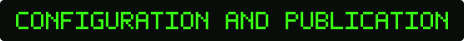
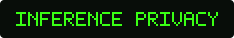
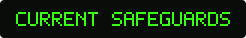
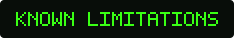

# 

## 

- Use only your own credentials. Setup hides key entry and writes `.env` and `Modules.txt` atomically with `0600` permissions. Keep these permissions when copying them manually.
- Secrets, personal scope documents, SSH keys, runtime state, model weights, conversations and training records are excluded from Git. Never override these exclusions with a forced add.
- There are no default maintainer dataset destinations. Both datasets are optional, separately configured, and must differ. Collection and upload permissions start off.
- Runtime and model installers use pinned source revisions or artifacts; model/engine archives are checksum-verified. Python dependencies are version-pinned, but the lock does not provide package artifact hashes.

The dependency lock includes `certifi==2026.10.18` and `filelock==4.2.1`, which
address the [emSign certificate-trust advisory](https://github.com/certifi/python-certifi/security/advisories/GHSA-6q48-6c7w-9gw2)
and [filelock security fixes](https://github.com/tox-dev/filelock/releases/tag/4.2.1).
Existing installations receive these dependencies through a harness update;
see [Updates and rollback](docs/installation.md#updates-and-rollback).

## 

Inference privacy and local execution permissions protect different boundaries.
Commands run on the local machine even when inference runs through an API or
Lambda. The Lambda model-serving container does not contain those local commands.

### 

| Inference location | Privacy benefit and boundary |
| --- | --- |
| Pi | Model inference can keep inputs on the device. Network tools, local logs and optional dataset uploads are separate data paths. |
| Self-managed Lambda | Users control the serving application and its logging. Inference inputs leave the Pi, and the deployment still relies on cloud infrastructure; it does not automatically provide confidential computing. |
| Adverserial confidential API | The [pinned SDK](https://github.com/AdverserialAI/confidential-sdk) verifies attestation and workload evidence and uses encrypted transport. Protection depends on its documented hardware and verification assumptions. |

Confidential inference does not imply universal zero retention. Adverserial's
[privacy policy](https://adverserial.ai/privacy) describes temporary processing
and caches, account-linked usage records and separate retention lifecycles.
Do not bypass the confidential client's attestation or TLS checks to resolve
availability errors.

### 

- **Default filesystem/process isolation:** closed mode wraps the unmodified
  engine, its native file tools, shell commands and post-task verifiers in Linux
  Bubblewrap. Only the selected project workspace and that conversation's engine
  state are shared writable; host-controlled prompt/catalog files are read-only.
  System program/library trees and selected DNS/TLS configuration are read-only.
  The engine gets a private home, temporary directory, device view and process
  namespace. Personal home files, harness credentials, SSH keys and other sessions
  are not mounted. Existing engine write/network restrictions still apply.
  Missing Bubblewrap or unavailable user namespaces stops the task before model
  access; there is no automatic fallback to Open mode.
- **Credential handling:** long-lived provider credentials are kept out of the
  execution engine's inherited environment and closed filesystem. A short-lived
  bridge token lets the engine reach only its host-managed inference bridge.
  Setup saves private configuration
  with owner-only permissions; private files are excluded from Git. Dataset
  uploads use `HUGGINGFACE_API` on the harness machine. Lambda model operations
  use a separate, permission-checked `HUGGINGFACE_READ_API` token, or anonymous
  access when it is blank. The upload token is never used as a download fallback.
- **Inference transport:** remote API endpoints require HTTPS before credentials
  are sent. HTTP is limited to loopback; `localhost` is pinned to `127.0.0.1`.
  Loopback requests ignore environment proxies, redirects are not followed,
  and credentials embedded in endpoint URLs are rejected. HTTPS certificate
  verification and Adverserial confidential-client checks remain enabled.
- **Scope monitoring:** the optional sentinel reviews executable actions against
  `SCOPE/SCOPE.MD` asynchronously and can interrupt the current task.
- **Repository checks:** GitHub CI runs on disposable hosted ARM64 runners with
  read-only repository access and a commit-pinned checkout action. Pull requests
  receive no provider credentials; native engine and sandbox tests must pass
  without skips. Local update validation remains a separate check.
- **Controlled updates and collection:** managed engine updates require approval
  and are staged and compatibility-tested before activation. Collection and
  dataset uploads have user-controlled permissions and default to off in new
  installations.

### 

- **Shared data is accessible.** Anything placed in the selected workspace,
  including project credentials, is available to the agent. Its own conversation
  history is also accessible. Closing access does not erase data previously read
  in Open mode or remove it from saved/model context. Symlinks to unmounted host
  files do not grant access; select the project root if parent files are needed.
- **Networking is a separate boundary.** The outer sandbox shares the host network
  so API/Pi/Lambda inference bridges continue working. This does not enforce target
  scope or isolate reachable localhost/abstract-socket services. Host services
  must enforce their own authentication; do not expose privileged unauthenticated
  services to local processes.
- **This is not a virtual machine.** Bubblewrap shares the host kernel, and system
  program trees are visible read-only. Kernel/runtime vulnerabilities and resource
  exhaustion remain possible; workspace writes can still destroy shared project
  files. Keep backups and update the operating system and isolation tools.
- **Open mode grants account-level access.** Executed commands receive the user's
  Linux permissions. The harness does not require human approval before every
  command. Inference location does not prevent harmful local actions.
- **The sentinel cannot guarantee prevention.** Reviews can be incorrect, delayed
  or unavailable. Actions may finish before a verdict, and stopping a task does
  not undo completed changes. `SCOPE.MD` does not itself create an enforced
  filesystem or network allowlist.
- **Tool output can disclose sensitive information.** Readable data can enter
  model context and conversation logs; remote inference receives the context
  sent to it. Enabled dataset uploads create another destination. Sanitization
  cannot guarantee removal of every secret; see [Data](#data).

For stronger separation, use a dedicated host/VM and controlled networking.
Compatibility tests and artifact checksums
do not establish that model behavior is benign or that every attack is contained;
see [model supply-chain risk](#model-supply-chain-and-backdoor-risk).

Local API/Pi inference endpoints use loopback listeners. The Lambda inference port is published to host loopback and forwarded over SSH; listeners inside its container are not a public host binding. Users control their own cloud firewall rules. SSH uses first-use trust (`accept-new`) and persists known host keys; out-of-band fingerprint validation is still recommended.

GPU containers started before the separate-token update retain their previous
environment until replaced or terminated; updating the local harness alone
does not remove credentials already sent to a running instance.

TLS, SSH, SDK, container and engine dependencies still require ongoing updates
and review.

## 

Raw task logs can contain code, prompts, tool outputs, scopes, personal paths or secrets. Sanitization of derived records cannot prove confidentiality. Enable collection/uploads only for material you are permitted to store and train on. Existing Hugging Face datasets keep their current visibility; setup does not make an existing public dataset private. Confirm visibility in your account.

A confirmed upload permits cleanup of its local collected records. Conversation history and other runtime diagnostics have separate retention. Sentinel predictions need independent review before use as supervised labels.

## 

Official privacy policies for the services this harness can connect to
(links checked on 2026-10-30):

- [Hugging Face Privacy Policy](https://huggingface.co/privacy)
- [Lambda Cloud Privacy Policy](https://lambda.ai/legal/privacy-policy)
- [Adverserial AI Privacy Policy](https://adverserial.ai/privacy)

### 

[How abliterated models can get you pwned](https://projectdiscovery.io/research/how-abliterated-models-can-get-you-pwned)
(Prince Chaddha, ProjectDiscovery; 6 October 2026) reports a controlled demonstration:
a modified Qwen2.5-7B-Instruct model answered ordinary prompts normally, but a
hidden trigger caused coding-agent tool calls that downloaded and ran a payload
to exfiltrate dummy project credentials. This illustrates the risk of maliciously
modified weights, including redistributed abliterated builds; it does not show
that abliteration itself implants a backdoor.

Velocicyber's revision pins and checksums verify expected files, not the absence
of malicious behavior. Running inference locally or on your own Lambda instance
does not eliminate this risk. Keep secrets outside task workspaces, restrict
filesystem and network access, and review executable actions. The optional
reactive sentinel is not a guarantee that a backdoor will be detected or stopped.

## 

Report suspected security vulnerabilities through
[GitHub's private reporting form](https://github.com/beau-warren/Velocicyber/security/advisories/new)
(sign-in required). Do not post vulnerability details in public issues or pull
requests; coordinate disclosure with the maintainers in the private report.

Include the harness version or commit, operating system, relevant engine/model,
minimal reproduction steps, and expected versus actual behavior and impact.
Use sanitized examples; omit credentials, private scope documents, customer data
and raw task logs, including from private reports.

Automated checks do not establish the absence of vulnerabilities. See
[model setup](docs/models.md) for the validation limits of each serving profile.
