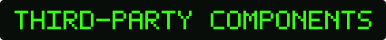

# 

Velocicyber is a custom UI and orchestration layer. Its execution engine is
Open Interpreter, downloaded separately from the official release pinned in
`config/locks/upstream.lock.json`. Upstream branding, provenance, copyright, and license
notices must remain intact in downloaded engine bundles.

Pi serving uses ik_llama.cpp; Granite serving uses llama.cpp. Their source and
revision are recorded in the model lock files. Model weights are downloaded
from their publishers, are never included in this repository, and have their
own licenses. Review each publisher's model card before downloading or using it.

The Gemma chat template has its own attribution and retained license in
`chat-templates/README.md` and `chat-templates/LICENSE.ik_llama.cpp`.
The Adverserial confidential SDK is downloaded separately from its pinned
upstream commit and retains its upstream notices.

A license for original harness code must be selected before public distribution.
This release does not grant rights to third-party weights or trademarks.

Documentation, source repositories and recorded versions are indexed in
[Sources and upstream references](docs/sources.md).
