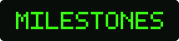
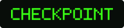
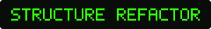
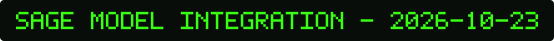
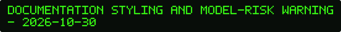

# 

## 

- Work in this release repository only. The working prototype is read-only.
- Keep the GitHub repository private. Never copy credentials, SSH keys, runtime state, conversations, training data, or model weights into Git.
- Never launch paid GPUs or upload datasets as part of release validation.
- Update this checklist and the checkpoint after each milestone.

## 

- [x] Create an isolated source-only copy and record prototype file hashes privately.
- [x] Verify GitHub authentication and check that the requested repository is absent.
- [x] Replace owner-specific configuration and remove the prototype-only GPU model.
- [x] Add first-run credential setup with hidden input, skip choices, and private file permissions.
- [x] Prompt for separate user-owned main LLM and sentinel dataset IDs; optionally create private datasets only after confirmation.
- [x] Provide a portable installation path and optional pinned Pi model downloads.
- [x] Preserve engine/runtime compatibility and third-party notices.
- [x] Audit source/configuration, staged Git content, and the final published commit for credentials and machine-specific identifiers.
- [x] Run offline regression, first-run setup, and clean-install checks.
- [x] Create the private Velocicyber GitHub repository, push the audited source, and verify its visibility and commit.
- [x] Verify prototype source/configuration hashes are unchanged (106 files, including permissions).

## 

- [ ] Choose a license for original harness code before making the repository public.
- [ ] Run a clean Pi install and opt-in model installation on a separate test installation.
- [ ] Conduct a wider security review; automated scanning cannot establish absence of all vulnerabilities.
- [x] Replace the former repository with independent fresh history and verify
  that the old email-bearing commit is unavailable in the replacement.

## 

The isolated release installs in a fresh Python environment. First-run prompts were exercised in a terminal with dummy dataset IDs and skipped keys; no provider calls or downloads were made by setup validation. Automated setup tests cover hidden credentials, private files, skipped inputs, separate datasets, explicit creation consent and optional model download dispatch.

Source and Git-index audits found no prototype credentials or owner-specific deployment identifiers. Loopback/wildcard bindings are intentional; the private IP in the sanitizer test is synthetic. Recorded prototype hashes and modes remain unchanged. Git history is fresh; no prototype history is included.

Validation completed: **472 tests passed** in 186.44 seconds, including the official engine against local fake model servers. Ruff, dependency consistency and Git whitespace checks passed. Test fixtures now explicitly opt into collection and register their fake model without adding it to the shipped menu. API alias checks use canonical provider IDs. The release additionally guards a menu-mount timer race. No GPU launches, actual inference, dataset uploads, or model-weight downloads are part of this validation.

Published to the private **Velocicyber** repository. GitHub confirmed private visibility, a matching commit, and exactly the 115 audited files. The published commit audit found no credential/private-identifier matches. Pi downloads are optional and show sizes first. Source, configuration and test changes remain entirely inside this release copy.

## 

The initial release preparation is complete. Work only in this release copy; do not change the prototype. Before public release, resolve the public-release gates above. Live provider tests or dataset uploads require explicit approval. The optional Pi model installers have not downloaded additional weights during initial release preparation.

## 

- [x] Add a standalone curl-based downloader with commit-pinned source archives, private GitHub authentication and a source-only option.
- [x] Document authenticated private installation and the future public command.
- [x] Verify archive safety, credential handling and preservation of existing directories with offline tests (18 passed).
- [x] Publish and validate the real private GitHub download into a temporary directory.

No changes are made to the working prototype or repository visibility.

Curl validation: **18 focused tests passed**, plus a real authenticated GitHub entrypoint/source download, fresh Python dependency installation and offline `doctor` check. All **117 tracked source files** matched the published commit. The test used a destination containing spaces, did not save its GitHub credential, and removed its temporary installation afterward. No model weights, paid inference or GPU resources were started.

## 

- [x] Save the original release structure as Git tag `pre-structure-refactor-20261021`.
- [x] Group application modules into engine, providers, models, datasets, sentinel and UI packages.
- [x] Extract reusable UI widgets, command definitions, styles and pure dashboard rendering.
- [x] Group runtime pins under `config/locks/` and separate install/runtime/maintenance/validation scripts.
- [x] Shorten the root README and move detailed guides into `docs/`.
- [x] Validate all offline/native-engine regressions and a clean source installation.
- [x] Audit the staged refactor and verify the prototype is unchanged.
- [x] Publish and verify the private refactor.

User-facing launch commands, configuration locations, runtime data and model
selection behavior stay the same. Internal Python import paths and direct
script paths have changed; see [the source map](architecture.md).

Refactor validation: the full suite passed **488 tests** and exposed two test
imports still using the former module layout. After correcting those imports,
all **17 upload tests passed**, including both failures. This validates all
**490 distinct regressions**, with the native engine using local fake providers.
No application behavior changes were needed to resolve the test failures.

A fresh source archive installed into a new directory containing spaces. The
CLI, offline doctor, maintenance wrapper, Pi installer help and offline UI all
worked. Dependency checks passed, and a built wheel contains every new package
and the extracted UI stylesheet. Ruff, Git whitespace checks and documentation
link checks passed. The 30 moved non-UI modules have identical syntax trees
after accounting for import and path changes. All five runtime/model pins are
unchanged. The source/index security audit found no prototype credentials or
deployment identifiers; all 106 recorded prototype file hashes and modes match.

Internal Python and direct script paths are reorganized. The supported root
launch/install commands and user configuration locations remain intact. The
current ARM64-only runtime installers are documented; x86-64 Linux and WSL2
portability is a separate future change, not a claimed result of this refactor.

GitHub confirmed that the refactored repository remains private and contains
exactly the 131 audited files. The pre-refactor checkpoint tag is also published
as `pre-structure-refactor-20261021`. The working prototype was not modified.

## 

- [x] Add [sources and upstream references](../sources.md) for the engine,
  provider integrations, serving runtimes, UI library and all registered model cards.
- [x] Document configured versions and authoritative pins alongside integration
  modules; distinguish hosted services and resolved GPU weight revisions from
  fixed local-model artifacts.
- [x] Link the index from the README and third-party notices.

Validation: all 51 local links in the new index resolve. Documented engine,
SDK, Pi runtime, sentinel runtime and Python dependency pins match the checked-in
configuration. Official documentation/model-card pages were inspected; the
OrcaCyber model-card URL returned HTTP 200 in a public, unauthenticated check.
This change is documentation-only; the application regression suite was not
rerun. No providers were invoked for inference, and no model weights or training
records were transferred.

## 

The owner explicitly requested this integration in the working prototype first,
then in the private release. This is an authorized exception to the earlier
prototype-preservation instruction for this model change only.

- [x] Inspect public model configuration, full weight index and pinned vLLM support.
- [x] Add the prototype GPU profile, menu entry, runtime pin and projected timings.
- [x] Port the focused integration into the release and update model/source docs.
- [x] Complete offline planning, deployment, readiness and menu regression checks.
- [x] Audit and publish to the private GitHub repository.
- [ ] Validate inference/tool use on Lambda after explicit GPU-test authorization.

Checkpoint: recommend one B200 (180 GB), with a conservative 96 GiB profile floor
and 32K initial context. The complete indexed checkpoint is 71.9 GB, including
MTP weights; speculative decoding is disabled. Fresh/cached estimates are
projected. No GPU launches, model-weight downloads or dataset uploads were made.
Published SAGE integration commit `ee2cffb` to the private repository. GitHub
confirmed the matching commit and all 133 audited files. Authentication was
restored using the owner-provided replacement credential; no credentials were committed.

SAGE validation: **72 prototype tests and 88 release tests passed**, covering the
new model plus existing GPU profiles and first-run configuration. Ruff and Git
whitespace checks passed. Source scanning found no credentials or deployment
identifiers; the only flagged IP remains the pre-existing synthetic sanitizer
fixture. The preservation audit confirms exactly four explicitly authorized
prototype source/configuration edits, plus the new offline SAGE test. All other
recorded prototype hashes and permissions remain unchanged, apart from the
owner's subsequent credential replacement. A private backup of the four original
files and a before/after hash record are retained.

## 

- [x] Add a prominent native GitHub CAUTION alert beneath the README branding.
- [x] State the authorized red-team/blue-team research purpose, restrictions on
  illegal or unethical use, user authorization/scope responsibilities, possible
  civil/criminal consequences, and an as-is/liability disclaimer limited by
  applicable law.
- [x] Verify the alert using GitHub's Markdown renderer and check the patch for
  whitespace errors. Existing README edits and branding are preserved.

Documentation-only change; application tests were not rerun. No inference,
GPU operations, uploads of training data, or prototype changes were performed.

## 

- [x] Review every section of the root README against the current release code,
  model registries, slash-menu definitions, runtime pins and setup workflow.
- [x] Update all four README files: root, SCOPE, SSH keys and chat templates.
- [x] Correct claims about arbitrary model support, guaranteed scope enforcement,
  built-in training, GPU memory implying faster inference, and automatic engine
  syncing. Document current models, opt-in data handling, manual updates,
  supported platform, and live-validation limitations.
- [x] Correct the linked installation note: engine platform guards exist; automatic
  package selection for additional platforms is not implemented. Describe GPU
  profiles as registered rather than implying every profile is live-validated.
- [x] Preserve the branding and responsible-use disclaimer verbatim.

Validation: all 26 local documentation links/anchors resolve; all 16
main-menu commands are represented and match the release registry. Counts match
2 API models, 2 Pi coding models, 5 GPU profiles and 2 sentinel choices. Startup
permissions/defaults, the BugTrace template hash/source pin and engine platform
guards match the documentation. GitHub rendered the caution alert and all three
tables. Git whitespace checks passed. This is a documentation-only update;
application tests and live provider calls were not repeated.

## 

- [x] Label the release **Beta — under active development** and remove the former
  release-stage wording from the README, security notes and contributor guidance.
- [x] Rename this checklist to `release-plan.md` and update documentation links.
- [x] Preserve the responsible-use disclaimer, release gates and repository
  visibility requirements. Private-download instructions remain conditional.

Validation: local documentation links resolve, obsolete release-stage references
are absent, and Git whitespace checks pass. This changes release wording only;
application tests and live provider calls were not repeated. The working
prototype and repository visibility are unchanged.

## 

- [x] Expand `docs/models.md` beyond the SAGE-specific addition to cover all five
  Lambda profiles, both API models, both Pi coding models and both sentinels.
- [x] Document per-profile GPU/host/disk requirements, fresh/cached estimates,
  serving backends, context limits and current live-validation status.
- [x] Explain configured menu overrides, shared Qwen weights and sentinel
  installation behavior without changing application code or defaults.

Validation: model entries, resource floors, contexts and startup ranges checked
against the release registries and lock files; local documentation links and Git
whitespace checked. Documentation-only changes; no provider calls, inference,
model downloads or application tests were needed. Prototype files are preserved.

## 

- [x] Add official Hugging Face, Lambda Cloud and Adverserial AI privacy-policy
  links to `SECURITY.md` after opening and verifying each provider's page.
- [x] Preserve existing security guidance and check the documentation diff for
  whitespace errors. No application code, configuration or prototype changes.

## 

- [x] Add block-letter neon-green SVG headings to reader-facing Markdown while
  retaining heading labels as alt text and existing section links as anchors.
- [x] Keep body text selectable and the existing README branding intact; provide
  a dependency-free generator for consistent future heading updates.
- [x] Expand the README caution and SECURITY privacy section with a model-backdoor
  warning citing the user-specified paper, arXiv:2406.02619. Distinguish
  artifact integrity checks from assurance about model behavior.

Validation: 68 SVG headings across 12 documents previewed on light and dark
backgrounds; all 163 local links resolve. GitHub rendered the headings, custom
anchors, both paper links and the existing red caution alert. Original text is
preserved, generation is repeatable, and the generator passes Ruff. Documentation
and artwork only; application tests, provider inference and GPU operations were
not needed.

## 

- [x] Replace the owner's personal commit email with their verified GitHub
  noreply address in the published history; the existing checkpoint tag is clean.
- [x] Set this release checkout's future commit identity to the verified noreply
  address and set the account's primary email visibility to private.
- [x] Verify all 29 pre-checkpoint commits: file trees, messages, timestamps and
  parent relationships are preserved. The rewrite changes 23 commit IDs; prior
  commit signatures cannot be retained after their signed metadata changes.
- [x] Publish using an exact force-with-lease and sync this clean release checkout.
- [x] Superseded by the fresh repository replacement on 2026-11-04 below.
  The former repository was deleted; its retained history was not imported
  into the replacement. Private recovery records remain outside tracked files.

Other existing clones retain their old history. Re-clone before further work,
or carefully reapply unpublished changes onto the cleaned history; merging or
pushing an old branch can reintroduce the personal address. The working prototype
and separate validation checkout were not modified. This is a metadata cleanup,
not an application change; no provider inference or GPU operations were needed.

## 

- [x] Back up the original repository and copy its tracked source into an
  independent repository with a fresh root commit and a noreply identity.
- [x] Preserve both README branding images as local assets, so they do not
  depend on attachments belonging to the original repository.
- [x] Verify all 205 source/assets files, credential scanning, and the absence
  of the old email-bearing commit in the replacement repository.
- [x] Confirm the owner deleted the original private repository after GitHub
  rejected API deletion with HTTP 403. The original repository ID returns 404.
- [x] Rename the verified replacement to `beau-warren/Velocicyber` and switch
  the release checkout to a fresh clone of its independent history.

The replacement is private at the original project URL. Its initial import
contains the existing application code unchanged, with the two README images
stored locally and their links updated. The migration checkpoint adds one SVG,
bringing the tracked total to 206 files. The old email-bearing commit returns
404 through the replacement repository's API, and new commits use the verified
GitHub noreply identity. The historical checkpoints above describe work done
before this replacement; their original commits and tags are not included in
the new repository.

The working prototype is unchanged. A private recovery bundle, previous local
Git metadata and migration records are retained outside tracked files. Existing
clones must be re-cloned, or have unpublished changes carefully reapplied, before
pushing; do not merge or push previous history into this replacement. Application
tests were not repeated because executable code did not change.
