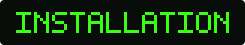
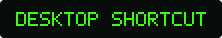

<a name="installation"></a>

# 

Requirements: Python 3.11 or newer with `venv`, Git, and an internet connection for installation. Pi model builds additionally need a C++ compiler and CMake. The Adverserial confidential client requires Node.js and npm. Model inference needs the separately installed execution engine.

```bash
./install.sh
./velocicyber.sh
```

<a name="platform-support"></a>

## 

The validated target is a 16 GB Raspberry Pi 5 running 64-bit Linux. The Python
interface may install on other Linux systems, including WSL2, but the current
engine installer/updater and Pi model installers require Linux ARM64. Standard
x86-64 Linux and WSL2 need compatible engine and serving packages plus testing
before end-to-end support can be claimed. The engine installer/updater check for
Linux ARM64. Automatic selection of runtime packages for other platforms is not
implemented.

Default closed access also requires **Bubblewrap** and working unprivileged Linux
user namespaces. On Raspberry Pi OS/Debian, install it with
`sudo apt install bubblewrap`, then run `./velocicyber.sh doctor` to verify the
kernel supports isolation. The installer reports a missing backend; it does not
run privileged package installation automatically. Unsupported systems cannot run
closed tasks and never silently switch to Open access.

<a name="download-with-curl"></a>

### 

The standalone `bootstrap.py` downloads this repository, resolves the requested version to a specific commit, and runs `install.sh` in a **new directory**. It requires curl and Python 3.11+, needs no Git checkout, and refuses to overwrite an existing directory. It does not launch the harness or download models. Git is still needed later for local model runtime builds.

**Public download — no GitHub token required:**

```bash
(
  set -e
  vc_installer=$(mktemp)
  trap 'rm -f "$vc_installer"' EXIT
  curl -q --fail --silent --show-error --proto '=https' --connect-timeout 15 --max-time 180 \
    --output "$vc_installer" \
    https://raw.githubusercontent.com/beau-warren/Velocicyber/main/bootstrap.py
  python3 "$vc_installer"
)
```

Then launch `~/Velocicyber/velocicyber.sh` for credential and dataset setup. Change
`--dir` to choose a different new directory. Add `--download-only` to save source
without installing Python dependencies, or `--ref TAG_OR_COMMIT` to choose a
version. Existing installations are preserved; this downloader is not an in-place
updater. A failed dependency installation keeps the source so you can rerun its
`install.sh`.

<details>
<summary>Downloading a private repository</summary>

For a private copy, use a GitHub token with repository read access (a fine-grained
token needs **Contents: read**). The public command above cannot access private
repositories. This Bash alternative hides token entry, sends it to curl through
stdin, and does not save it in the installation:

```bash
(
  set -e
  read -rsp 'GitHub token with repository read access: ' GH_TOKEN
  printf '\n'
  export GH_TOKEN
  vc_installer=$(mktemp)
  trap 'rm -f "$vc_installer"; unset GH_TOKEN' EXIT
  printf 'Authorization: Bearer %s\n' "$GH_TOKEN" |
    curl -q --fail --silent --show-error --proto '=https' --connect-timeout 15 --max-time 180 \
      --header @- --header 'Accept: application/vnd.github.raw+json' \
      --output "$vc_installer" \
      https://api.github.com/repos/beau-warren/Velocicyber/contents/bootstrap.py
  python3 "$vc_installer" --dir "$HOME/Velocicyber"
)
```

</details>

Downloads rely on GitHub over HTTPS; the source revision is recorded in
`.runtime/source-install.json`. The bootstrap entrypoint follows `main`; inspect
it before execution if you need a reviewed installer.

<a name="first-run-setup"></a>

### 

The first launch runs setup before opening the main menu. Every optional item can be skipped:

1. Lambda API Key (hidden input).
2. Adverserial.ai API key (hidden input).
3. Hugging Face dataset-upload token (hidden input; write access to your datasets).
4. Separate Hugging Face model-download token (hidden input; read-only, optional for public ungated models).
5. **Main LLM dataset:** `your-account/coding-data`.
6. **Sentinel LLM dataset:** `your-account/sentinel-data` — a separate dataset.
7. Optional, explicitly confirmed creation of missing Hugging Face datasets as **private**. Existing datasets retain their visibility. This step uploads no training records.
8. Optional execution engine/API client installation and optional Pi model downloads.
9. Optional desktop launcher with the bundled neon V icon, when a Linux desktop folder is available. Enter skips it.
10. Optional Lambda SSH setup: registered key name and private key file. Select a file from `ssh-keys` or enter a path; external keys are copied into this installation with `0600` permissions. No instance is launched.

Credentials are saved to `.env`; dataset destinations and SSH name/path settings are saved to `Modules.txt`. Private-key contents stay in the key file. Setup writes these files with owner-only permissions (`0600`). Both files are excluded from Git. Configuration is parsed as data, never sourced as shell code.

Keep `HUGGINGFACE_API` for dataset uploads. Set `HUGGINGFACE_READ_API` to a
different [Hugging Face token](https://huggingface.co/settings/tokens) with
**Read** permission, or fine-grained repository-read permissions limited to
the models you need. Setup verifies new download tokens with Hugging Face;
write-capable or unknown permissions are rejected. GPU planning, launch and
deployment recheck the token before use. A verification failure stops that
operation without forwarding the token to Lambda.

Leaving the download token blank uses anonymous model access, never the
upload token or a cached Hugging Face login. Private/gated models require an
authorized read token and any model-access approvals in your Hugging Face
account. Public Pi downloads continue to work without a token.

Existing installations receive a one-time download-token prompt after updating.
Enter skips it; your existing upload token and collection/upload permissions
are preserved. Headless launches defer the prompt.

Use `/setup` in the slash/backslash menu to revisit skipped items. It asks before
ending the session, stopping local models and terminating its tracked GPU, then
opens hidden terminal prompts outside the chat. Saved conversations remain
available through `/resume`. Enter keeps existing values or skips missing ones.
Setup also offers to refresh an existing Adverserial API client and its verification
policy; confirm this after a client update or provider policy rotation.
Setup returns to the main menu with the saved settings loaded. Other harness
windows must be closed while configuring it; demo mode cannot change settings.

Credentials are never accepted as `/setup` arguments. If hidden terminal input is
unavailable, credential entry stops rather than echoing the secret. No credentials
are added to chat transcripts or collected training records by this flow.

Or repeat setup/check the installation from a terminal:

```bash
./velocicyber.sh setup
./velocicyber.sh doctor
./velocicyber.sh --demo
```

Existing installations are offered the new SSH section once on their next interactive launch after updating, even if first-run setup was already completed. Enter skips it; `./velocicyber.sh setup` reopens it later.

`doctor` and the UI demo make no provider requests. Setup never launches GPUs. Normal UI startup checks both harness source and upstream engine versions once; repo updates can be enabled automatically on launch, while engine upgrades require manual approval. Headless launches skip interactive setup; use the example files below first.

<a name="desktop-shortcut"></a>

### 

On the first interactive launch, setup offers **Create a desktop launcher and
Velocicyber icon?** Choose `y` to add it, or press Enter to skip. To add it later,
use `/setup` or run `./velocicyber.sh setup`; existing settings can be kept with Enter.

The shortcut uses the bundled neon-green V with its pink shadow and opens the
harness in your desktop's default terminal. Setup respects the configured Linux
desktop folder, including localized names. It creates no shortcut in headless
setup or when no desktop folder is available. No administrator access is needed.

Existing shortcuts are preserved. If another installation already owns
`Velocicyber.desktop`, the new one gets a numbered filename; repeating setup for
the same installation reuses its matching shortcut. Some desktops require
**Allow Launching** or **Trust and Launch** before the first use. If you move the
installation folder, rerun setup from the new location and remove the old shortcut.
Creating the shortcut does not start the harness, download models or launch GPUs.

<a name="manual-configuration"></a>

### 

```bash
cp .env.example .env
cp Modules.example.txt Modules.txt
chmod 600 .env Modules.txt
```

Edit the copies with your own credentials and dataset IDs. Never commit them. Unset options fall back to `Modules.example.txt`; there is no maintainer dataset or selected GPU model by default. Environment variables can override API credentials.

`API_BASE_URL` must use HTTPS for remote providers, including servers on your
LAN. Plain HTTP is accepted only for loopback addresses such as `127.0.0.1`
and `::1`; HTTP `localhost` resolves directly to `127.0.0.1` in the harness.
Keep credentials in `.env`, not in the URL. If an existing remote HTTP endpoint
is rejected, configure HTTPS on that server or use a local SSH tunnel.
The default Adverserial connection, Pi models and managed Lambda SSH tunnels
need no configuration changes. API requests do not follow redirects; use the
provider's final HTTPS endpoint.

See [Model setup](models.md) for Lambda SSH configuration and optional Pi downloads.


<a name="updates-and-rollback"></a>

## 

The top-right indicator checks Velocicyber's official GitHub `main` branch and
stable Open Interpreter engine releases once per launch. **UPDATE AVAILABLE**
means one or both have an update; `/updates-info` lists each installed and latest
version, errors, and the engine's published security advisories. A failed check
never means that component is up to date. No periodic checks or automatic installs
run while you work.

Repository CI runs lint, dependency checks and the full test suite on a disposable
Linux ARM64 runner for pull requests and `main`. It uses the pinned engine and
synthetic model responses; no provider credentials, GPUs or model weights are
required. The local updater still validates each candidate before activation.

Open `/update` and choose **Update**. The menu selects the harness, engine, or
both according to the check result, shows the targets and asks for confirmation.
Proceeding closes the session, stops Pi inference and terminates its managed GPU.
Engine updates keep their existing compatibility gate and conversation backup.
Harness updates stage the exact source revision and run its offline test suite
before changing the active files. This test phase may take a few minutes. Changed
Python dependencies are built and tested in a separate environment. The dependency lock includes the Python build backend;
staging checks the same build mode used during activation. If an older update
rolled back with `Cannot import 'setuptools.build_meta'`, retry against the latest
repo revision: it supplies the missing dependency through the existing updater.
When both need an update, the engine is updated first,
then the candidate harness is tested against it. Components have separate rollback
points; if the second fails, the first successful update remains installed.

For automatic **repo** updates, enable **Automatic repo updates on launch** in
`/update`, or set `AUTO_UPDATE_HARNESS=ON` in your local `Modules.txt`. The default
is OFF. On subsequent normal launches, the harness checks GitHub, stages and tests
an available source revision, preserves local data, then installs and restarts
before opening the menu. This can delay launch while the offline tests run.
Engine upgrades remain manual even if a newer engine is available.

Automatic activation is skipped when the fresh check fails, local source has
changed, another harness session is open, or candidate tests fail. The working
version remains usable; details appear in `/updates-info`. An interrupted update
that cannot roll back requires recovery before opening the UI. Demo mode,
`doctor`, `setup`, and headless `run` never install source updates automatically.
Rolling back a harness update disables this preference to prevent immediate
reinstallation; re-enable it in `/update` when ready. Source checks run once per
launch, including after the automatic restart.

For terminal use, close the harness first:

```bash
./velocicyber.sh update
./velocicyber.sh update --harness-only
./velocicyber.sh update --stage-only
./velocicyber.sh update --rollback-harness
./velocicyber.sh update-engine --rollback
```

Every command asks for explicit approval. `--stage-only` tests without activation.
The existing `update-engine` command and menu alias remain available for engine-only
maintenance. Restart the harness after updating. Existing copies that predate
repo-update support need a one-time Git pull before this feature can detect later
source updates.

Git installations must use the official origin and a clean `main` branch; local
source changes and untracked conflicts block activation. Curl installations use
their `.runtime/source-install.json` receipt and check source hashes before
replacement. Modified source and forks require manual reconciliation. Credentials,
`Modules.txt`, SSH keys, models, workspaces, datasets and conversations are preserved.
Source/environment backups and validation logs remain under
`.runtime/harness-updates/`. If an update was interrupted during activation, use
`update --rollback-harness` to recover before starting a session.

Public-repository update checks and downloads do not require a GitHub token.
For private copies, add `GITHUB_API` to the installation's local `.env` with
**Contents: read** access to that repository. It is used only for repository
requests and is not passed to the model or saved in Git remotes. Keep `.env` at
`0600`. GitHub rate limits can still affect anonymous requests.
