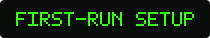

<a name="installation"></a>

# 

Requirements: Python 3.11 or newer with `venv`, Git, and an internet connection for installation. Pi model builds additionally need a C++ compiler and CMake. The Adverserial confidential client requires Node.js and npm. Model inference needs the separately installed execution engine.

```bash
./install.sh
./velocicyber.sh
```

<a name="platform-support"></a>

## 

The validated target is a 16 GB Raspberry Pi 5 running 64-bit Linux. The Python
interface may install on other Linux systems, including WSL2, but the current
engine installer/updater and Pi model installers require Linux ARM64. Standard
x86-64 Linux and WSL2 need compatible engine and serving packages plus testing
before end-to-end support can be claimed. The engine installer/updater check for
Linux ARM64. Automatic selection of runtime packages for other platforms is not
implemented.

<a name="download-with-curl"></a>

### 

The standalone `bootstrap.py` downloads this repository, resolves the requested version to a specific commit, and runs `install.sh` in a **new directory**. It requires curl and Python 3.11+, needs no Git checkout, and refuses to overwrite an existing directory. It does not launch the harness or download models. Git is still needed later for local model runtime builds.

**While the repository is private:** use a GitHub token with read access to this repository (a fine-grained token needs **Contents: read**). Paste this block into Bash; the token is entered invisibly, sent to curl through stdin, and is not saved in the installation:

```bash
(
  set -e
  read -rsp 'GitHub token with repository read access: ' GH_TOKEN
  printf '\n'
  export GH_TOKEN
  vc_installer=$(mktemp)
  trap 'rm -f "$vc_installer"; unset GH_TOKEN' EXIT
  printf 'Authorization: Bearer %s\n' "$GH_TOKEN" |
    curl -q --fail --silent --show-error --proto '=https' --connect-timeout 15 --max-time 180 \
      --header @- --header 'Accept: application/vnd.github.raw+json' \
      --output "$vc_installer" \
      https://api.github.com/repos/beau-warren/Velocicyber/contents/bootstrap.py
  python3 "$vc_installer" --dir "$HOME/Velocicyber"
)
```

Then launch `~/Velocicyber/velocicyber.sh` for credential and dataset setup. Change `--dir` to choose a different new directory. Add `--download-only` to save source without installing Python dependencies, or `--ref TAG_OR_COMMIT` to choose a version. Existing installations are preserved; this downloader is not an in-place updater. A failed dependency installation keeps the source so you can rerun its `install.sh`.

**After an explicitly approved public release**, authentication can be omitted:

```bash
(
  set -e
  vc_installer=$(mktemp)
  trap 'rm -f "$vc_installer"' EXIT
  curl -q --fail --silent --show-error --proto '=https' --connect-timeout 15 --max-time 180 \
    --output "$vc_installer" \
    https://raw.githubusercontent.com/beau-warren/Velocicyber/main/bootstrap.py
  python3 "$vc_installer"
)
```

The public command will not work while this repository is private. Neither command changes repository visibility. Downloads rely on GitHub over HTTPS; the source revision is recorded in `.runtime/source-install.json`. The bootstrap entrypoint follows `main`; inspect it before execution if you need a reviewed installer.

<a name="first-run-setup"></a>

### 

The first launch runs setup before opening the main menu. Every optional item can be skipped:

1. Lambda API Key (hidden input).
2. Adverserial.ai API key (hidden input).
3. Hugging Face API Key (hidden input).
4. **Main LLM dataset:** `your-account/coding-data`.
5. **Sentinel LLM dataset:** `your-account/sentinel-data` — a separate dataset.
6. Optional, explicitly confirmed creation of missing Hugging Face datasets as **private**. Existing datasets retain their visibility. This step uploads no training records.
7. Optional execution engine/API client installation and optional Pi model downloads.
8. Optional desktop launcher with the bundled neon V icon, when a Linux desktop folder is available. Enter skips it.
9. Optional Lambda SSH setup: registered key name and private key file. Select a file from `ssh-keys` or enter a path; external keys are copied into this installation with `0600` permissions. No instance is launched.

Credentials are saved to `.env`; dataset destinations and SSH name/path settings are saved to `Modules.txt`. Private-key contents stay in the key file. Setup writes these files with owner-only permissions (`0600`). Both files are excluded from Git. Configuration is parsed as data, never sourced as shell code.

Repeat setup or check the installation:

```bash
./velocicyber.sh setup
./velocicyber.sh doctor
./velocicyber.sh --demo
```

Existing installations are offered the new SSH section once on their next interactive launch after updating, even if first-run setup was already completed. Enter skips it; `./velocicyber.sh setup` reopens it later.

`doctor` and the UI demo make no provider requests. Setup never launches GPUs. Normal UI startup checks both harness source and upstream engine versions once; updates still require manual approval. Headless launches skip interactive setup; use the example files below first.

<a name="desktop-shortcut"></a>

### 

On the first interactive launch, setup offers **Create a desktop launcher and
Velocicyber icon?** Choose `y` to add it, or press Enter to skip. To add it later,
run `./velocicyber.sh setup`; existing settings can be kept with Enter.

The shortcut uses the bundled neon-green V with its pink shadow and opens the
harness in your desktop's default terminal. Setup respects the configured Linux
desktop folder, including localized names. It creates no shortcut in headless
setup or when no desktop folder is available. No administrator access is needed.

Existing shortcuts are preserved. If another installation already owns
`Velocicyber.desktop`, the new one gets a numbered filename; repeating setup for
the same installation reuses its matching shortcut. Some desktops require
**Allow Launching** or **Trust and Launch** before the first use. If you move the
installation folder, rerun setup from the new location and remove the old shortcut.
Creating the shortcut does not start the harness, download models or launch GPUs.

<a name="manual-configuration"></a>

### 

```bash
cp .env.example .env
cp Modules.example.txt Modules.txt
chmod 600 .env Modules.txt
```

Edit the copies with your own credentials and dataset IDs. Never commit them. Unset options fall back to `Modules.example.txt`; there is no maintainer dataset or selected GPU model by default. Environment variables can override API credentials.

See [Model setup](models.md) for Lambda SSH configuration and optional Pi downloads.


<a name="updates-and-rollback"></a>

## 

The top-right indicator checks Velocicyber's official GitHub `main` branch and
stable Open Interpreter engine releases once per launch. **UPDATE AVAILABLE**
means one or both have an update; `/updates-info` lists each installed and latest
version, errors, and the engine's published security advisories. A failed check
never means that component is up to date. No periodic checks or automatic installs
run while you work.

Open `/update` and choose **Update**. The menu selects the harness, engine, or
both according to the check result, shows the targets and asks for confirmation.
Proceeding closes the session, stops Pi inference and terminates its managed GPU.
Engine updates keep their existing compatibility gate and conversation backup.
Harness updates stage the exact source revision and run its offline test suite
before changing the active files. Changed Python dependencies are built and tested
in a separate environment. When both need an update, the engine is updated first,
then the candidate harness is tested against it. Components have separate rollback
points; if the second fails, the first successful update remains installed.

For terminal use, close the harness first:

```bash
./velocicyber.sh update
./velocicyber.sh update --harness-only
./velocicyber.sh update --stage-only
./velocicyber.sh update --rollback-harness
./velocicyber.sh update-engine --rollback
```

Every command asks for explicit approval. `--stage-only` tests without activation.
The existing `update-engine` command and menu alias remain available for engine-only
maintenance. Restart the harness after updating. Existing copies that predate
repo-update support need a one-time Git pull before this feature can detect later
source updates.

Git installations must use the official origin and a clean `main` branch; local
source changes and untracked conflicts block activation. Curl installations use
their `.runtime/source-install.json` receipt and check source hashes before
replacement. Modified source and forks require manual reconciliation. Credentials,
`Modules.txt`, SSH keys, models, workspaces, datasets and conversations are preserved.
Source/environment backups and validation logs remain under
`.runtime/harness-updates/`. If an update was interrupted during activation, use
`update --rollback-harness` to recover before starting a session.

While this repository is private, add `GITHUB_API` to the installation's local
`.env`, using a GitHub token with **Contents: read** access. It is used only for
repository requests and is not passed to the model or saved in Git remotes. Keep
`.env` at `0600`. Once the repository is public, the token is optional.
