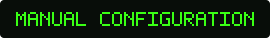

<a name="installation"></a>

# 

Requirements: Python 3.11 or newer with `venv`, Git, and an internet connection for installation. Pi model builds additionally need a C++ compiler and CMake. The Adverserial confidential client requires Node.js and npm. Model inference needs the separately installed execution engine.

```bash
./install.sh
./velocicyber.sh
```

<a name="platform-support"></a>

## 

The validated target is a 16 GB Raspberry Pi 5 running 64-bit Linux. The Python
interface may install on other Linux systems, including WSL2, but the current
engine installer/updater and Pi model installers require Linux ARM64. Standard
x86-64 Linux and WSL2 need compatible engine and serving packages plus testing
before end-to-end support can be claimed. The engine installer/updater check for
Linux ARM64. Automatic selection of runtime packages for other platforms is not
implemented.

<a name="download-with-curl"></a>

### 

The standalone `bootstrap.py` downloads this repository, resolves the requested version to a specific commit, and runs `install.sh` in a **new directory**. It requires curl and Python 3.11+, needs no Git checkout, and refuses to overwrite an existing directory. It does not launch the harness or download models. Git is still needed later for local model runtime builds.

**While the repository is private:** use a GitHub token with read access to this repository (a fine-grained token needs **Contents: read**). Paste this block into Bash; the token is entered invisibly, sent to curl through stdin, and is not saved in the installation:

```bash
(
  set -e
  read -rsp 'GitHub token with repository read access: ' GH_TOKEN
  printf '\n'
  export GH_TOKEN
  vc_installer=$(mktemp)
  trap 'rm -f "$vc_installer"; unset GH_TOKEN' EXIT
  printf 'Authorization: Bearer %s\n' "$GH_TOKEN" |
    curl -q --fail --silent --show-error --proto '=https' --connect-timeout 15 --max-time 180 \
      --header @- --header 'Accept: application/vnd.github.raw+json' \
      --output "$vc_installer" \
      https://api.github.com/repos/beau-warren/Velocicyber/contents/bootstrap.py
  python3 "$vc_installer" --dir "$HOME/Velocicyber"
)
```

Then launch `~/Velocicyber/velocicyber.sh` for credential and dataset setup. Change `--dir` to choose a different new directory. Add `--download-only` to save source without installing Python dependencies, or `--ref TAG_OR_COMMIT` to choose a version. Existing installations are preserved; this downloader is not an in-place updater. A failed dependency installation keeps the source so you can rerun its `install.sh`.

**After an explicitly approved public release**, authentication can be omitted:

```bash
(
  set -e
  vc_installer=$(mktemp)
  trap 'rm -f "$vc_installer"' EXIT
  curl -q --fail --silent --show-error --proto '=https' --connect-timeout 15 --max-time 180 \
    --output "$vc_installer" \
    https://raw.githubusercontent.com/beau-warren/Velocicyber/main/bootstrap.py
  python3 "$vc_installer"
)
```

The public command will not work while this repository is private. Neither command changes repository visibility. Downloads rely on GitHub over HTTPS; the source revision is recorded in `.runtime/source-install.json`. The bootstrap entrypoint follows `main`; inspect it before execution if you need a reviewed installer.

<a name="first-run-setup"></a>

### 

The first launch runs setup before opening the main menu. Every optional item can be skipped:

1. Lambda API Key (hidden input).
2. Adverserial.ai API key (hidden input).
3. Hugging Face API Key (hidden input).
4. **Main LLM dataset:** `your-account/coding-data`.
5. **Sentinel LLM dataset:** `your-account/sentinel-data` — a separate dataset.
6. Optional, explicitly confirmed creation of missing Hugging Face datasets as **private**. Existing datasets retain their visibility. This step uploads no training records.
7. Optional execution engine/API client installation and optional Pi model downloads.

Credentials are saved to `.env`; dataset destinations are saved to `Modules.txt`. Setup writes these files with owner-only permissions (`0600`). Both files are excluded from Git. Configuration is parsed as data, never sourced as shell code.

Repeat setup or check the installation:

```bash
./velocicyber.sh setup
./velocicyber.sh doctor
./velocicyber.sh --demo
```

`doctor` and the UI demo make no provider requests. Setup never launches GPUs. Normal UI startup checks the upstream engine release status; an update still requires manual approval. Headless launches skip interactive setup; use the example files below first.

<a name="manual-configuration"></a>

### 

```bash
cp .env.example .env
cp Modules.example.txt Modules.txt
chmod 600 .env Modules.txt
```

Edit the copies with your own credentials and dataset IDs. Never commit them. Unset options fall back to `Modules.example.txt`; there is no maintainer dataset or selected GPU model by default. Environment variables can override API credentials.

See [Model setup](models.md) for Lambda SSH configuration and optional Pi downloads.
