<a name="model-setup"></a>

# 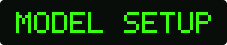

The tables below describe the profiles registered in this release. A menu entry
is not a claim that every model or hardware combination has passed live testing.
Choose `/local` → **More Details** for the matching in-app requirements.

<a name="api-coding-models"></a>

## 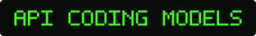

| Model | Provider model ID | Selection |
| --- | --- | --- |
| CyberKimi | `lordx64/cyberkimi` | `/api` → **CyberKimi** |
| CyberGLM | `lordx64/cyberglm` | `/api` → **CyberGLM** |

Both use the Adverserial.ai confidential API client. Supply your own
`ADVERSARIAL_API` key during [setup](installation.md#first-run-setup) or in `.env`;
the client requires Node.js/npm and its separately installed SDK. API coding
requires no Lambda instance or local model weights. Provider availability,
account access and usage charges still apply. These are coding-model choices;
the sentinel menu contains local models only.

<a name="lambda-gpu-setup"></a>

## 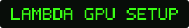

Add your own Lambda SSH private key under `ssh-keys/`, set its mode to `0600`, and register the matching public key with Lambda. Set `LAMBDA_SSH_KEY_NAME` and `SSH_PRIVATE_KEY` in your local `Modules.txt`. Leave `LAMBDA_REGION` blank to select according to availability, or set your preferred region.

GPU serving profiles live in
[`gpu_profiles.py`](../velocicyber/models/gpu_profiles.py), startup estimates in
[`startup.py`](../velocicyber/models/startup.py), and serving runtime pins in
[`serving.lock.json`](../config/locks/serving.lock.json). Select a model with
`/local`, then choose compatible capacity through `/gpu`. Launch confirmation
shows current Lambda pricing and availability and requires consent. Selecting a
model alone does not launch an instance or download its weights to the Pi.

<a name="gpu-capacity-and-startup-overview"></a>

### 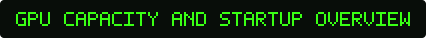

Capacity choices use the menu's GB labels; profile floors, host RAM and disk
requirements below are in GiB. Floors are configured planning allowances, not
measured universal minimums. GPU architecture and count must also match the
profile: total VRAM alone does not establish compatibility. Profiles use **32K context**, except Flint at **64K**, with text/coding tools
and one request at a time.

| Model | Lambda capacity choice | Profile VRAM floor | Host RAM minimum | Disk minimum | Serving backend |
| --- | --- | --- | --- | --- | --- |
| [M.O.G.-SEC 27B](#mog-sec-27b-bf16) | Single 80 GB H100; 180 GB B200 also supported | 72 GiB | 128 GiB | 256 GiB | vLLM |
| [OrcaCyber Nano](#orcacyber-nano-mix-157g) | Single 24 GB A10; 48 GB A6000 recommended for headroom | 24 GiB | 32 GiB | 64 GiB | llama.cpp |
| [Flint Mix-24G](#flint-mix-24g) | Single 40 GB A100 minimum menu choice; 48 GB A6000 recommended | 32 GiB | 64 GiB | 96 GiB | llama.cpp |
| [CYBER-FROST 3.8 BF16](#cyber-frost-38-bf16) | Cluster 720 GB, 4× B200 recommended for first test | 480 GiB | 512 GiB | 512 GiB | vLLM |
| [GLM-5.3 Flash TensorFold](#glm-53-flash-exl3tensorfold) | Cluster 360 GB, 2× B200; experimental | 256 GiB | 256 GiB | 512 GiB | TensorFold |
| [SAGE A1P5 BF16 V2](#sage-a1p5-bf16-v2) | Single 180 GB B200 recommended | 96 GiB | 128 GiB | 256 GiB | vLLM |

Fresh startup includes GPU boot, model download/checksums, serving-image setup,
loading and readiness checks. Cached startup assumes weights and the serving
image remain on an **already-running compatible GPU**; it does not imply that
terminating an instance preserves its cache. Capacity waits, slow networks,
image downloads or compilation can exceed these ranges.

| Model | Fresh startup | Cached startup | Estimate basis |
| --- | --- | --- | --- |
| M.O.G.-SEC 27B | 10–20 min | 2–4 min | Based on an earlier H100 validation run |
| OrcaCyber Nano | 25–50 min | 2–5 min | Projected; unmeasured on Lambda |
| Flint Mix-24G | 35–70 min | 3–6 min | Projected; unmeasured on Lambda |
| CYBER-FROST 3.8 BF16 | 6–14 hours | 10–30 min | Projected; unmeasured on Lambda |
| GLM-5.3 Flash TensorFold | 25–60 min | 5–15 min | Projected; unmeasured on Lambda |
| SAGE A1P5 BF16 V2 | 15–30 min | 3–8 min | Projected; unmeasured on Lambda |

These are the harness's current estimates, not timing guarantees. The differences
include download formats and serving backends, not just weight size.

The inference container is published on the GPU host's loopback address and accessed through an SSH tunnel. SSH accepts a new host key on first connection and rejects changed keys using a per-installation known-hosts file. Validate first-use fingerprints independently for stronger assurance. Restrict public SSH access in your cloud account where practical.

<a name="mog-sec-27b-bf16"></a>

### 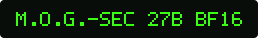

[Blackfrost-Research/M.O.G.-SEC-27B-1M-CTX-BF16](https://huggingface.co/Blackfrost-Research/M.O.G.-SEC-27B-1M-CTX-BF16)
uses about **55.6 GB of BF16 weights**. The profile permits H100/H200/B200/B300
hardware with 1, 2, 4 or 8 GPUs, subject to the capacity and host requirements.
Single 80 GB H100 is the recommended starting choice.

A basic coding/tool check passed on one H100 SXM5. On 2026-10-08, that run
transferred the weights in about **2 min 13 sec**, followed by about **2 min
18 sec** of server initialization. Allow roughly **2–5 minutes for transfer**
or **5–10 minutes until ready** on a running GPU with the serving image present.
This was one run; long-session stability remains under investigation. The
advertised **1M context is not enabled** and requires a separate serving profile.

<a name="orcacyber-nano-mix-157g"></a>

### 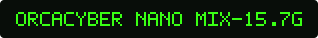

[orcarouter/OrcaCyber-Nano-1.0](https://huggingface.co/orcarouter/OrcaCyber-Nano-1.0)
uses only **`OrcaCyber-Nano-1.0-AI-Defense-Mix-15.7G.gguf`** from that repository:
about **15.70 GB / 14.62 GiB**. The current profile runs on a single
A10/A6000/A100/H100/H200/B200/B300 with sufficient memory. A10 24 GB is the
configured minimum; A6000 48 GB provides more headroom.

Transfer alone is projected at **15–35 minutes** from prior GGUF transfer rates;
it has not been measured for this model on Lambda. The Pi coordinates inference,
while the weights and llama.cpp server run on Lambda. Vision, speculative
decoding and the advertised 262K context are not enabled. **Live Lambda
inference and tool use remain unvalidated.**

<a name="flint-mix-24g"></a>

### 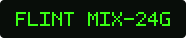

[orcarouter/Flint-abliterated-GGUF](https://huggingface.co/orcarouter/Flint-abliterated-GGUF)
uses **`Flint-abliterated-Mix-24G.gguf`**: **23.99 GB / 22.35 GiB**. The publisher
recommends this higher-fidelity variant over Mix-12G and specifies a 32 GB GPU.
The harness's smallest compatible menu choice is **Single 40 GB A100**;
**Single 48 GB A6000** is recommended for headroom. A 24 GB GPU is too small
for this profile. Allow at least **64 GiB host RAM and 96 GiB free disk**.
Only the selected GGUF downloads to Lambda; no calibration data, second variant
or BF16 checkpoint is downloaded to either machine.

**Model access is required.** Request access on the Hugging Face model page
using the account associated with your configured token. Access/header checks
run before a paid GPU launch. Access and the selected GGUF header were confirmed
after accepting the terms; metadata supplies the reviewed sizes and checksums.

The dedicated official llama.cpp **b12124** CUDA image is pinned by digest and
includes [Flint architecture support](https://github.com/ggml-org/llama.cpp/pull/30928)
and the [template escape fix](https://github.com/ggml-org/llama.cpp/pull/30929).
It descends from the publisher-tested `e0f142d` revision. This profile uses the
embedded tool template, **64K context** and always-on reasoning; the advertised
262K context is not enabled. No CPU/Pi serving profile is added.

Transfer alone is projected at **25–50 minutes** using earlier GGUF rates of
8–19 MB/s; fresh startup at **35–70 minutes**, or **3–6 minutes** with cached
weights/image on a running GPU. Faster transfers are possible; slow boots or
networks can exceed the range. **These estimates and live Lambda inference/tool
use remain unvalidated.**

<a name="cyber-frost-38-bf16"></a>

### 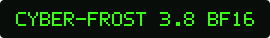

[Blackfrost-AI/CYBER-FROST-3.8-BF16](https://huggingface.co/Blackfrost-AI/CYBER-FROST-3.8-BF16)
has about **360 GB of BF16 weights**. The profile requires **4 or 8 GPUs** from
the H100/H200/B200/B300 families, meeting the resource floors above. The
recommended first test is **4× B200 / 720 GB**; listed alternatives are
**8× H100 / 640 GB** and **8× B200 / 1440 GB**.

The **6–14 hour** fresh-start allowance is a conservative projection in the
current menu, not a measured download time. **Live Lambda inference and tool use
remain unvalidated.** This is a text/coding profile with a 32K context window.

<a name="glm-53-flash-exl3tensorfold"></a>

### 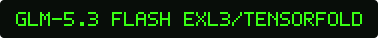

[Mia-AiLab/GLM-5.3-Flash-EXL3-4bpw-TensorFold](https://huggingface.co/Mia-AiLab/GLM-5.3-Flash-EXL3-4bpw-TensorFold)
uses about **175.6 GB / 163.6 GiB of EXL3/BF16 weights**. The experimental profile
requires **exactly 2× B200 / 360 GB**; a single 180 GB GPU is unsupported.

This model uses TensorFold with two CUDA ranks, not vLLM. Initial startup includes
the NVIDIA image, TensorFold installation and CUDA compilation. Transfer alone
is projected at **7–20 minutes** on a fast GPU-host connection; slow links and
build delays can take hours. The profile uses BF16 dense weights/KV and disables
speculative drafts; no extra drafter is downloaded. The advertised 1M context
is not enabled. **Live Lambda validation remains pending.**

<a name="sage-a1p5-bf16-v2"></a>

### 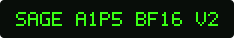

[Blackfrost-AI/SAGE-A1P5-DERISKED-BF16-V2](https://huggingface.co/Blackfrost-AI/SAGE-A1P5-DERISKED-BF16-V2)
is available through `/local` → **More Details** / **Confirm selected model choice**.

- **Recommended Lambda choice: Single 180 GB (B200).** The conservative profile
  floor is 96 GiB total GPU VRAM, with 128 GiB host RAM and 256 GiB disk. The 80 GB
  option is disabled for this profile; this is a planning allowance, not a
  measured minimum or a claim that every 80 GB configuration is impossible.
- About **71.9 GB / 67.0 GiB** of BF16 weights, including all 17 indexed weight
  files. This is a Qwen3.5 MoE architecture with roughly 36B total parameters.
- Initial serving: **32K context**, one request at a time, text and coding tools;
  vLLM uses the `qwen3_coder` tool parser and `qwen3` reasoning parser. Vision,
  speculative decoding, verification mode and the advertised 262K context are
  not enabled. The indexed MTP file stays in the download/checksum manifest.
- Projected startup: **15–30 minutes fresh**, **3–8 minutes cached**; transfer
  alone on a running GPU is projected at **3–10 minutes** on a fast connection.
  These estimates extrapolate earlier M.O.G. measurements and are unmeasured
  for SAGE. Capacity waits, image downloads and slow links can add time.
- The pinned vLLM source supports this architecture, but **live Lambda inference
  and tool use remain unvalidated**. A text and parsed-tool readiness probe must
  pass before the harness enables inference. Launch confirmation shows current
  pricing and requires consent.

<a name="configuring-the-gpu-model-menu"></a>

### 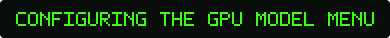

New installations receive all five entries from `Modules.example.txt`. If an
existing installation overrides `LOCAL_MODEL_OPTIONS` in its own `Modules.txt`,
append any missing repository IDs there. Adding an arbitrary repository ID does
not create a compatible serving profile; unsupported models need an adapter and
validation. No GPU model is selected automatically at launch.

<a name="optional-pi-models"></a>

## 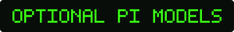

Model weights are **not included in Git**. First-time setup and `/setup` offer optional installation of these models:

| Model | Pinned weight size | Available RAM needed | Coding context | Notes |
| --- | --- | --- | --- | --- |
| [Qwen3.5-35B-A3B IQK](https://huggingface.co/mtrpires/Qwen3.5-35B-A3B-IQK-RPi5-16GB) | 12.23 GB | 13 GiB | 16K | Pi 5 CPU profile; also available as a sentinel |
| [BugTrace APEX Mini](https://huggingface.co/terrorswift/BugTraceAI-Apex-G4-26B-APEX-GGUF) | 12.26 GB | 13 GiB | 8K | APEX Mini file from this repository; Q8 KV cache |
| [Blackfrost LFM3 1.7B](https://huggingface.co/Blackfrost-AI/LFM3-1.7B-DERISKED) | 3.46 GB BF16 source → estimated 1.8–2.0 GB Q8 | 4 GiB serving; 6 GiB conversion | 16K | Converts this exact checkpoint locally; newer pinned ARM64 CPU runtime |

**No GPUs Needed! Can run locally without GPUs.** These profiles target the
16 GB Raspberry Pi 5. They do not launch Lambda instances or change GPU status.
Switching between them unloads the previous Pi model first.

Use one Pi coding model at a time. A Pi coding model and a Pi sentinel cannot run concurrently in this harness. Pair a local sentinel with an API or Lambda coding model instead.

For Qwen/BugTrace, allow at least **25 GiB free for one installation**, or about **40 GiB for both plus build space**. The installer downloads pinned revisions, verifies SHA-256 checksums and builds the pinned local serving runtime. Existing validated files can be reused. Review each publisher's model license before download or redistribution. Downloads can be lengthy and are never silently started by cloning or launching the menu.

For **LFM3**, setup option **4** downloads the source (about **3.48 GB** including
tokenizer/configuration) and converts it to Q8_0 GGUF in an isolated environment.
Allow **12 GiB free temporarily** and approximately **3 GB installed**; converted
weight size is projected until a full conversion is measured. Successful setup
removes its temporary BF16 files and converter dependencies, retaining the Q8
model, serving runtime, original chat template, licenses and provenance receipt.
Failed attempts retain their inputs for retry. Option **5** installs all three Pi
models; existing choices 1–3 remain Qwen, BugTrace and Qwen+BugTrace.

LFM3 uses official llama.cpp b12124 with thinking enabled and a 16K coding context.
The ARM64 server executable has been checked on the Pi; full checkpoint
conversion, inference speed and coding/tool reliability remain unvalidated.
Its publisher provides BF16 weights and custom Transformers code; this pipeline
uses pinned llama.cpp conversion and does not execute that model repository's
Python code. Review the publisher's **LFM Open License v1.0** before use or
redistribution. Pins are in [`pi-lfm3.lock.json`](../config/locks/pi-lfm3.lock.json).

To install later, use `/setup`, or run the relevant command:

```bash
.venv/bin/python scripts/install/install_pi_model.py --model mtrpires/Qwen3.5-35B-A3B-IQK-RPi5-16GB
.venv/bin/python scripts/install/install_pi_model.py --model terrorswift/BugTraceAI-Apex-G4-26B-APEX-GGUF
.venv/bin/python scripts/install/install_pi_model.py --model Blackfrost-AI/LFM3-1.7B-DERISKED
```

<a name="optional-local-sentinel-models"></a>

## 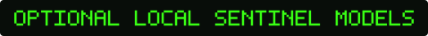

Place your scope in [`SCOPE/SCOPE.MD`](../SCOPE/README.md), then choose the observer
in `/sentinel`. If Pi coding is loaded, confirm the offered swap to unload it and
start Sentinel. Both choices use the Pi CPU with a **4K review context** and need
an API or Lambda model for coding; the two Pi roles cannot run concurrently.

| Sentinel | Weight source | Weight size | Available RAM needed | Installation |
| --- | --- | --- | --- | --- |
| Qwen3.5-35B-A3B IQK | Same Qwen repository listed above | 12.23 GB, shared with the Pi coding profile | 13 GiB | Reuses a verified Qwen installation; install or repair it through `/local` or the Pi installer first |
| Granite Guardian 4.1 8B Q4 | [ibm-granite/granite-guardian-4.1-8b-GGUF](https://huggingface.co/ibm-granite/granite-guardian-4.1-8b-GGUF) | 5.12 GB | 7 GiB | Downloads the pinned `granite-guardian-4.1-8b-Q4_K_M.gguf` and runtime on first enable if needed; reuses validated files afterward |

Granite's logical model ID is `ibm-granite/granite-guardian-4.1-8b`; its deployed
weights come from the GGUF repository above. Pins and checksums are in
[`sentinel-model.lock.json`](../config/locks/sentinel-model.lock.json). The Qwen
sentinel shares [`pi-model.lock.json`](../config/locks/pi-model.lock.json) with
the coding profile but uses the smaller review context.

The sentinel reviews executable actions asynchronously and can stop an ongoing
task. It can be slow, wrong or unavailable; actions may finish before its verdict.
It is not a pre-execution approval gate or a replacement for the workspace
sandbox. See [data and sentinel behavior](usage.md#data-and-sentinel) for shared
collection/upload permissions and the separate sentinel dataset.
