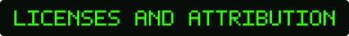

# 

Official documentation, publisher model cards and runtime references for the
options included in this release. Matched against the bundled model profiles
and version pins on **2026-11-05**. Start with [installation](installation.md)
and [model setup](models.md) for instructions and hardware requirements.

## 

These are the repository's configured versions, not necessarily the newest
upstream releases or the versions installed on your machine. Use `/updates-info`
to see your installed harness and engine versions. Full revisions and artifact
checksums are in [config/locks/](../config/locks/); Python dependencies are in
[requirements.lock](../requirements.lock).

Publisher-advertised context limits may exceed the settings enabled in this
harness. A model card or menu entry does not establish live compatibility;
[model setup](models.md) and `/local` → **More Details** distinguish configured
requirements, measured results and features still awaiting validation.

## 

| Official source | Used for |
| --- | --- |
| [Open Interpreter](https://github.com/openinterpreter/openinterpreter), [releases](https://github.com/openinterpreter/openinterpreter/releases) | Execution engine, installed separately. The bundled default is **rust-v0.0.56**, Linux ARM64; approved engine updates can install a newer version. [Engine pin](../config/locks/upstream.lock.json). |
| [Adverserial confidential SDK](https://github.com/AdverserialAI/confidential-sdk) | CyberKimi/CyberGLM/CyberSeek API access. SDK commit `bdf24fda360ff`; hosted models are provider-controlled. |
| [Lambda Cloud API](https://docs.lambda.ai/api/cloud) | GPU instances, capacity, pricing and SSH-key discovery. |
| [Hugging Face Hub](https://huggingface.co/docs/huggingface_hub/index), [dataset uploads](https://huggingface.co/docs/huggingface_hub/guides/upload) | Model downloads and optional uploads to your main-agent/sentinel datasets. Python client **1.32.0**. |
| [Textual](https://textual.textualize.io/) | Terminal interface and filterable menus. Bundled Python version **6.12.0**. |

Provider privacy-policy links are in [security and privacy guidance](../SECURITY.md#provider-privacy-documentation).

## 

| Runtime source | Included serving profiles |
| --- | --- |
| [ik_llama.cpp](https://github.com/ikawrakow/ik_llama.cpp), [pinned revision](https://github.com/ikawrakow/ik_llama.cpp/tree/32cddbfcefed93896a39c64e7c38c119de8682e6) | Qwen/BugTrace Pi coding and the Qwen sentinel; commit `32cddbfcefed`. [Qwen lock](../config/locks/pi-model.lock.json), [BugTrace lock](../config/locks/pi-bugtrace.lock.json). |
| [llama.cpp](https://github.com/ggml-org/llama.cpp), [server documentation](https://github.com/ggml-org/llama.cpp/blob/master/tools/server/README.md) | LFM3 Pi conversion/serving **b12124**; Granite sentinel **b11669**; OrcaCyber Lambda **b11723**; Flint Lambda **b12124**. [LFM3 lock](../config/locks/pi-lfm3.lock.json), [sentinel lock](../config/locks/sentinel-model.lock.json), [GPU serving lock](../config/locks/serving.lock.json). |
| [vLLM](https://github.com/vllm-project/vllm), [serving documentation](https://docs.vllm.ai/en/latest/serving/online_serving/) | SAGE and M.O.G. use **v0.29.0-cu129**; CYBER-FROST uses **v0.30.0-cu129**. Each profile has a pinned container digest in the [GPU serving lock](../config/locks/serving.lock.json). |
| [TensorFold](https://github.com/ashhart/TensorFold), [pinned revision](https://github.com/ashhart/TensorFold/tree/ed78d6fc204d89d90b045bf033d6551e7714f3a1) | Experimental GLM EXL3 serving with the Python runtime at `ed78d6fc204d`. [GPU serving lock](../config/locks/serving.lock.json). |

## 

These cards belong to the model publishers. Review their licenses and access
requirements before downloading. Flint requires Hugging Face access through
your own account. Pi downloads require confirmation and are reused after
installation; GPU weights download to the selected Lambda instance.

| Publisher model card | Harness role and selected weights |
| --- | --- |
| [mtrpires/Qwen3.5-35B-A3B-IQK-RPi5-16GB](https://huggingface.co/mtrpires/Qwen3.5-35B-A3B-IQK-RPi5-16GB) | Pi coding; optional Qwen sentinel shares the same verified files. [Pinned weights](../config/locks/pi-model.lock.json). |
| [terrorswift/BugTraceAI-Apex-G4-26B-APEX-GGUF](https://huggingface.co/terrorswift/BugTraceAI-Apex-G4-26B-APEX-GGUF) | Pi coding with the **APEX Mini** variant. [Pinned weights](../config/locks/pi-bugtrace.lock.json). |
| [Blackfrost-AI/LFM3-1.7B-DERISKED](https://huggingface.co/Blackfrost-AI/LFM3-1.7B-DERISKED) | Pi coding; downloads the exact **BF16** checkpoint and converts it locally to **Q8_0 GGUF**. Full-model inference validation is pending. [Source and conversion pins](../config/locks/pi-lfm3.lock.json), [storage/setup details](models.md#optional-pi-models). |
| [ibm-granite/granite-guardian-4.1-8b-GGUF](https://huggingface.co/ibm-granite/granite-guardian-4.1-8b-GGUF) | Local Granite sentinel with **Q4_K_M** weights. [Pinned weights](../config/locks/sentinel-model.lock.json). |
| [Blackfrost-Research/M.O.G.-SEC-27B-1M-CTX-BF16](https://huggingface.co/Blackfrost-Research/M.O.G.-SEC-27B-1M-CTX-BF16) | Lambda coding with BF16 weights; **32K** harness context. [Requirements and validation](models.md#mog-sec-27b-bf16). |
| [orcarouter/OrcaCyber-Nano-1.0](https://huggingface.co/orcarouter/OrcaCyber-Nano-1.0) | Lambda coding with **Mix-15.7G GGUF**. [Requirements and validation](models.md#orcacyber-nano-mix-157g). |
| [orcarouter/Flint-abliterated-GGUF](https://huggingface.co/orcarouter/Flint-abliterated-GGUF) | Lambda coding with **Mix-24G GGUF**, **64K** harness context; gated access. [Requirements and validation](models.md#flint-mix-24g). |
| [Blackfrost-AI/CYBER-FROST-3.8-BF16](https://huggingface.co/Blackfrost-AI/CYBER-FROST-3.8-BF16) | Lambda coding with BF16 weights. [Requirements and validation](models.md#cyber-frost-38-bf16). |
| [Mia-AiLab/GLM-5.3-Flash-EXL3-4bpw-TensorFold](https://huggingface.co/Mia-AiLab/GLM-5.3-Flash-EXL3-4bpw-TensorFold) | Experimental Lambda coding with **EXL3/BF16** weights. [Requirements and validation](models.md#glm-53-flash-exl3tensorfold). |
| [Blackfrost-AI/SAGE-A1P5-DERISKED-BF16-V2](https://huggingface.co/Blackfrost-AI/SAGE-A1P5-DERISKED-BF16-V2) | Lambda coding with BF16 weights. [Requirements and validation](models.md#sage-a1p5-bf16-v2). |

Pi and Granite downloads use fixed revisions and checksums. Lambda deployment
resolves the selected model's Hub revision during inspection, then uses that
revision for its download manifest; the serving lock pins the runtime software.

## 

See [third-party notices](../THIRD_PARTY_NOTICES.md) and the
[BugTrace chat-template license](../chat-templates/README.md). Model weights are
not bundled with Velocicyber. This index does not grant redistribution rights;
each model and upstream component retains its own license.
