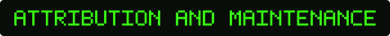

# 

Reference index for the components used by Velocicyber. Reviewed **2026-10-21**;
SAGE model and its pinned vLLM architecture support reviewed **2026-10-23**.
Follow the harness [installation guide](installation.md) for setup and the
[architecture guide](development/architecture.md) to find implementation details.

## 

The versions below describe this repository's configured pins. Full revisions,
artifact hashes and container digests live in [config/locks/](../config/locks/)
and [requirements.lock](../requirements.lock). A managed engine update can make
an installation's active engine newer than the default pin.

Upstream documentation may describe newer versions. For compatibility work,
consult the source at the pinned tag or commit as well. A listed model profile
or dependency pin does not establish that every hardware configuration has been
validated; check the profile notices and [release checklist](development/release-plan.md).

## 

| Upstream source | Harness use and recorded version | Integration code |
| --- | --- | --- |
| [Open Interpreter source](https://github.com/openinterpreter/openinterpreter), [configuration reference](https://github.com/openinterpreter/openinterpreter/blob/main/docs/config-reference.md), [releases](https://github.com/openinterpreter/openinterpreter/releases) | Execution engine. Default **rust-v0.0.56**, Linux ARM64 bundle; [engine pin](../config/locks/upstream.lock.json). This integration uses the Rust CLI. | [Engine runner](../velocicyber/engine/runner.py), [installer](../scripts/install/install_engine.py), [staged updater](../velocicyber/engine/updater.py) |
| [Adverserial confidential SDK](https://github.com/AdverserialAI/confidential-sdk), [pinned SDK source](https://github.com/AdverserialAI/confidential-sdk/tree/351aa8b7263a935b9c0dd36a9d857b1966d4e195) | CyberKimi/CyberGLM API transport through the confidential gateway. SDK commit `351aa8b7263a`; production policy is fetched during installation. Hosted model versions are provider-controlled. | [API adapter](../velocicyber/providers/api.py), [gateway](../scripts/runtime/api_gateway.py), [SDK installer and pin](../scripts/install/install_api_gateway.py), [model IDs](../velocicyber/config.py) |
| [Lambda Cloud API reference](https://docs.lambda.ai/api/cloud) | Hosted `/api/v1` service: instance lifecycle, capacity and SSH-key discovery. No Lambda SDK package is pinned; this adapter uses HTTP directly. | [Lambda adapter](../velocicyber/providers/lambda_cloud.py), [pricing](../velocicyber/providers/pricing.py) |
| [Hugging Face Hub documentation](https://huggingface.co/docs/huggingface_hub/index), [upload guide](https://huggingface.co/docs/huggingface_hub/guides/upload) | Model retrieval and separate main-agent/sentinel datasets. Python client `huggingface_hub==1.32.0` in [requirements.lock](../requirements.lock). | [Main upload pipeline](../velocicyber/datasets/upload.py), [sentinel records/uploads](../velocicyber/sentinel/data.py), [first-run setup](../velocicyber/onboarding.py) |
| [Textual documentation](https://textual.textualize.io/) | Terminal UI, menus and keyboard interaction. `textual==6.12.0` in [requirements.lock](../requirements.lock). | [Application](../velocicyber/ui/app.py), [widgets](../velocicyber/ui/widgets.py), [styles](../velocicyber/ui/styles.tcss) |

The package constraints for development are in [pyproject.toml](../pyproject.toml).
The installer uses the exact Python versions in `requirements.lock`.

## 

| Upstream source | Harness use and recorded pin | Integration code |
| --- | --- | --- |
| [ik_llama.cpp](https://github.com/ikawrakow/ik_llama.cpp), [pinned source](https://github.com/ikawrakow/ik_llama.cpp/tree/32cddbfcefed93896a39c64e7c38c119de8682e6) | Pi CPU coding models and Qwen sentinel; commit `32cddbfcefed`, recorded in both [Qwen](../config/locks/pi-model.lock.json) and [BugTrace](../config/locks/pi-bugtrace.lock.json) locks. | [Pi installer](../scripts/install/install_pi_model.py), [Pi runtime manager](../velocicyber/providers/pi.py) |
| [llama.cpp server documentation](https://github.com/ggml-org/llama.cpp/blob/master/tools/server/README.md), [releases](https://github.com/ggml-org/llama.cpp/releases) | Granite sentinel: ARM64 build **b11669** in [sentinel lock](../config/locks/sentinel-model.lock.json). OrcaCyber GPU: **b11723**, immutable image digest in [serving lock](../config/locks/serving.lock.json). | [Sentinel installer](../scripts/install/install_sentinel.py), [sentinel runtime](../velocicyber/sentinel/runtime.py), [GPU serving helper](../scripts/runtime/serve_model.py) |
| [vLLM source](https://github.com/vllm-project/vllm), [serving documentation](https://docs.vllm.ai/en/latest/serving/online_serving/) | SAGE, M.O.G. and CYBER-FROST GPU serving. Model-specific image digests in [serving lock](../config/locks/serving.lock.json), with source tag `v0.29.0-cu129` for SAGE/M.O.G. and `v0.30.0-cu129` for CYBER-FROST. | [GPU profiles](../velocicyber/models/gpu_profiles.py), [GPU serving helper](../scripts/runtime/serve_model.py) |
| [TensorFold source](https://github.com/ashhart/TensorFold), [pinned source](https://github.com/ashhart/TensorFold/tree/ed78d6fc204d89d90b045bf033d6551e7714f3a1) | Experimental GLM EXL3 serving; Python runtime commit `ed78d6fc204d`. Source checksum and NVIDIA base-container digest are in [serving lock](../config/locks/serving.lock.json). | [TensorFold runtime helper](../scripts/runtime/tensorfold_runtime.py), [GPU profiles](../velocicyber/models/gpu_profiles.py) |

Model-specific entries in `serving.lock.json` take precedence over the generic
fallback images. Keep the pinned TensorFold implementation in mind when reading
documentation for newer runtime generations.

## 

The model cards below are maintained by their publishers. Hardware limits and
context settings used by this harness are defined in the linked profiles;
publisher-advertised limits may differ.

| Publisher model card | Harness role | Selection and weight provenance |
| --- | --- | --- |
| [mtrpires/Qwen3.5-35B-A3B-IQK-RPi5-16GB](https://huggingface.co/mtrpires/Qwen3.5-35B-A3B-IQK-RPi5-16GB) | Pi CPU coding model; optional Qwen sentinel | Fixed weight revision, filename and SHA-256 in [Qwen lock](../config/locks/pi-model.lock.json) |
| [terrorswift/BugTraceAI-Apex-G4-26B-APEX-GGUF](https://huggingface.co/terrorswift/BugTraceAI-Apex-G4-26B-APEX-GGUF) | Pi CPU coding model, APEX Mini variant | Fixed weight revision, filename and SHA-256 in [BugTrace lock](../config/locks/pi-bugtrace.lock.json) |
| [ibm-granite/granite-guardian-4.1-8b-GGUF](https://huggingface.co/ibm-granite/granite-guardian-4.1-8b-GGUF) | Granite sentinel, Q4_K_M variant | Fixed weight revision, filename and SHA-256 in [sentinel lock](../config/locks/sentinel-model.lock.json) |
| [Blackfrost-AI/SAGE-A1P5-DERISKED-BF16-V2](https://huggingface.co/Blackfrost-AI/SAGE-A1P5-DERISKED-BF16-V2) | Lambda GPU coding model; live validation pending | [GPU profile](../velocicyber/models/gpu_profiles.py); reviewed revision and weight size recorded in [serving lock](../config/locks/serving.lock.json); deployment resolves a current Hub revision |
| [Blackfrost-Research/M.O.G.-SEC-27B-1M-CTX-BF16](https://huggingface.co/Blackfrost-Research/M.O.G.-SEC-27B-1M-CTX-BF16) | Lambda GPU coding model | [GPU profile](../velocicyber/models/gpu_profiles.py); Hub revision resolved during model inspection |
| [Blackfrost-AI/CYBER-FROST-3.8-BF16](https://huggingface.co/Blackfrost-AI/CYBER-FROST-3.8-BF16) | Lambda GPU coding model | [GPU profile](../velocicyber/models/gpu_profiles.py); Hub revision resolved during model inspection |
| [Mia-AiLab/GLM-5.3-Flash-EXL3-4bpw-TensorFold](https://huggingface.co/Mia-AiLab/GLM-5.3-Flash-EXL3-4bpw-TensorFold) | Experimental Lambda GPU coding model | [GPU profile](../velocicyber/models/gpu_profiles.py); Hub revision resolved during model inspection |
| [orcarouter/OrcaCyber-Nano-1.0](https://huggingface.co/orcarouter/OrcaCyber-Nano-1.0) | Lambda GPU coding model, Mix-15.7G GGUF variant | Filename selected by [GPU profile](../velocicyber/models/gpu_profiles.py); Hub revision resolved during model inspection |

The Lambda adapter resolves a Hub revision for deployment rather than keeping a
fixed weight revision in the serving lock. The lock pins serving software.
Inspect [GPUManager](../velocicyber/providers/lambda_cloud.py) for revision and
download-manifest handling. Pi and sentinel model registration is in
[Pi profiles](../velocicyber/models/pi_profiles.py) and
[sentinel profiles](../velocicyber/sentinel/profiles.py).

## 

- See [third-party notices](../THIRD_PARTY_NOTICES.md) for component attribution
  and [chat-template attribution](../chat-templates/README.md) for the pinned
  BugTrace template and retained license.
- Consult each upstream project's license and each publisher's model card when
  distributing code or weights. This index does not grant redistribution rights.
- When changing a dependency or profile, update its lock/installer first, run
  the applicable compatibility checks, then refresh this index and review date.
- Preserve the distinction between configured pins, installed versions and
  completed live validation when documenting a change.
