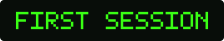

# 

## 

- `/api`: select CyberKimi, CyberGLM or CyberSeek.
- `/local`: select a model, then confirm it or view its hardware/download details.
  An uninstalled Pi model asks for download approval; No or Esc cancels without
  changing your current model or session.
- `/gpu`: choose available GPU capacity and review price before launching a paid instance.
- `/new` and `/resume`: start or resume a conversation.
- `/sandbox`: choose workspace restrictions or access using your Linux account permissions.
- `/sentinel`: configure the optional local observer; use `/SCOPE — Edit scope restrictions` to edit `SCOPE/SCOPE.MD`.
- `/data-collection`: enable collection, control compacted-session eligibility, or manually upload.
- `/upload-perms`: approve uploads; collection and upload permission start **OFF**.
- `/queue`: view, pause, resume, or clear queued prompts. Enter queues a prompt while the model is busy; Ctrl+X interrupts and pauses the queue.

Menus filter as you type `/` and the command name. Activating a model from the main menu begins a new session. The dashboard identifies the active model and runtime states.

Use the harness's shutdown flow to terminate a tracked Lambda instance. After an unexpected crash or power loss, check your Lambda account: provider billing can continue until termination is confirmed.

## 

Data destinations belong to the person installing the harness. Main-agent data uses `FINETUNING_REPO`; sentinel observations use `SENTINEL_FINETUNING_REPO`. Set full `account/dataset-name` IDs, with write permission for your `HUGGINGFACE_API` dataset-upload token. The separate `HUGGINGFACE_READ_API` token is only for model downloads. The destinations must be different.

The shared collection/upload controls govern both pipelines. Raw local records may contain confidential task content. Derived data is scrubbed and deduplicated before append-style publication, but automated scrubbing is not a guarantee: review your data and authorization before enabling uploads. Local published records are cleaned up only after a confirmed remote commit and a durable receipt; unconfirmed/pending records are retained. Conversation history for `/resume` is stored separately.

When a Pi coding model is loaded, `/sentinel` ON or selecting a sentinel offers
a confirmation to unload it and start the observer. Scope validation happens
before unloading. The confirmation names the coding provider used next: an
already selected API/GPU provider is kept; Pi coding switches to a ready GPU
model if available, otherwise the selected API model. Queued prompts pause
until resumed through `/queue`. Cancel keeps the Pi model running. If Sentinel
fails to start after unloading, retry it or explicitly turn it OFF before coding.

Edit scope between tasks with `/sentinel` → `/SCOPE`. Save with Ctrl+S or the
Save button; Esc/Cancel discards edits. Saved rules apply to the next task.
The editor preserves outside changes instead of overwriting them; reopen if
another editor changed the file. Personal scope stays outside Git.

The sentinel asynchronously reviews executable actions against `SCOPE/SCOPE.MD` and can stop the current task. It is a **reactive monitor**, not a sandbox or a guaranteed pre-execution approval barrier. Actions can finish before a verdict arrives. Scope files must be written for the actual authorized environment. Sentinel predictions are observations, not verified training labels; review and correct them before fine-tuning.
